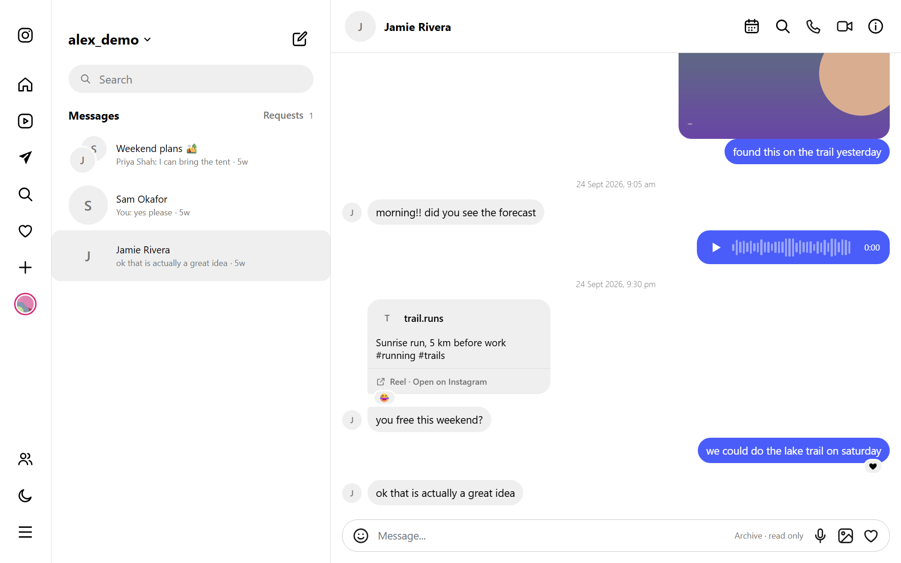
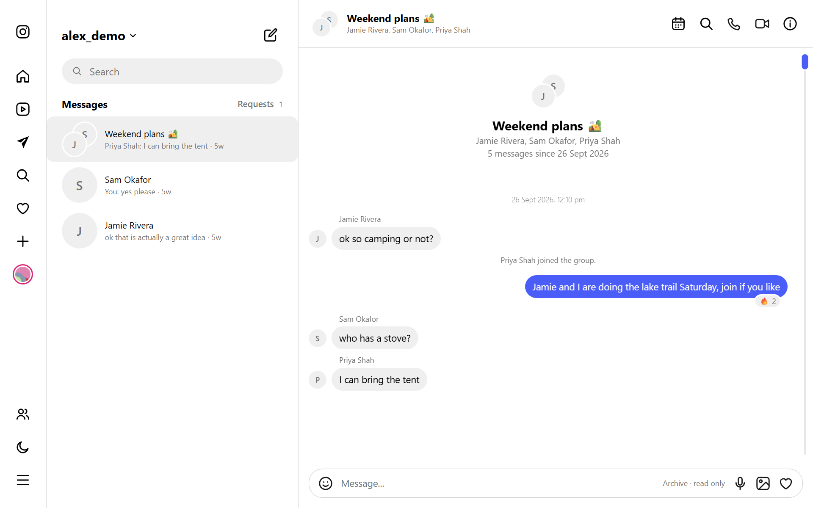
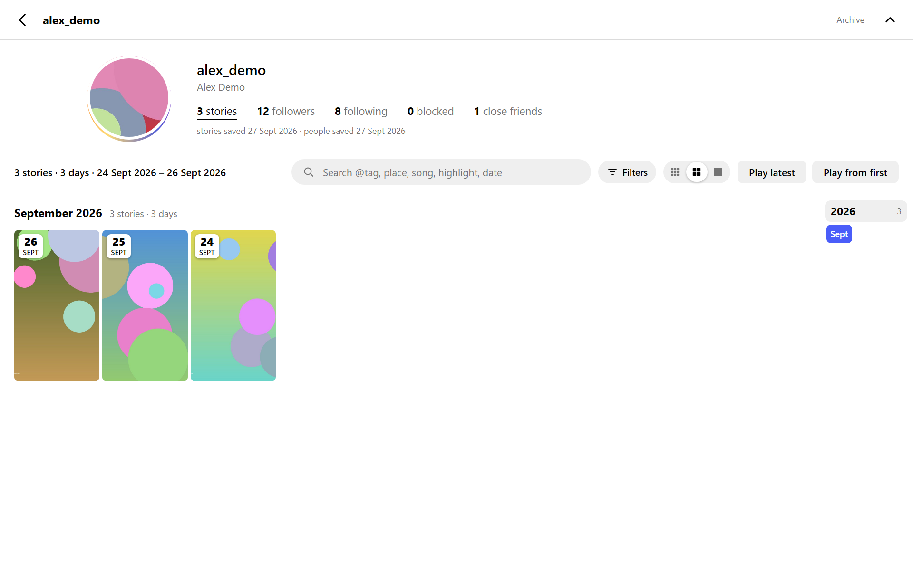
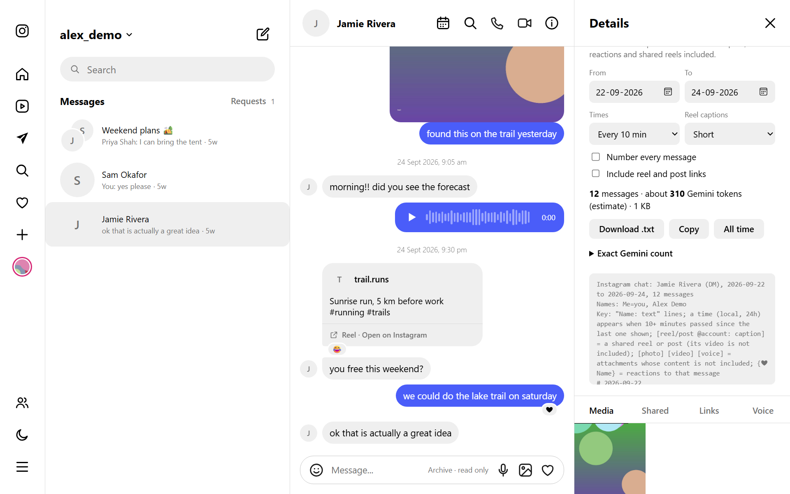

# instagram-takeout

Browse your Instagram data offline. Point it at the **official "Download your information" export** and get an Instagram Direct look-alike for your own chats, stories, followers and following, with no account login, no server and no cloud. Everything stays on your computer.

[](https://github.com/UdayPS-4o/instagram-takeout/actions/workflows/ci.yml)
[](LICENSE)



> The screenshots show a made-up account from [`tools/make_demo.py`](tools/make_demo.py). No real data is in this repository.

## Why

Instagram's own export is a pile of JSON files and a media folder that is hard to read, and its text is garbled (UTF-8 saved as Latin-1, so every emoji and non-English name is broken). This tool fixes that and turns the pile into something you can scroll, search and keep.

## Features

- **Chats**: every DM, group and message request, with photos, videos, voice notes, files, shared reels and posts, story replies, reactions, calls and group events. A message-request tab, group photos, a media/links/voice gallery per chat, a calendar to jump to any date, and search across all chats.
- **Stories**: a grid of every story you posted, with a viewer, filters and search.
- **People**: followers, following, blocked accounts and close friends.
- **Many accounts**: each account is its own folder, with a switcher.
- **Several sources per account**: import every export you ever download and they are merged, with newer messages added and nothing duplicated. Scraped JSON (see below) merges in the same way.
- **Export a chat for an LLM**: compact plain text for any date range, with replies, reactions and shared reels kept, plus a Gemini token count. See [below](#export-a-chat-for-an-llm).
- **Works offline**: the generated viewer is a static page. Open it from a file or serve it with one command. Light and dark mode, mobile layout.
- **Private by design**: your data is in `accounts/`, which is git-ignored. The viewer never contacts Instagram.

| Group chat | Stories | Export for AI |
| --- | --- | --- |
|  |  |  |

## Quick start

You need Python 3.10 or newer. [Pillow](https://pypi.org/project/pillow/) is optional: it lets the viewer reserve space for pictures while they load.

1. **Get your export.** Instagram > Accounts Center > Your information and permissions > Download your information. Choose *Download to device*, *All time* and format **JSON** (HTML cannot be read). Wait for the email and download the zip (or zips).
2. **Import it.**

   ```bash
   python import_export.py instagram-yourname-2026-10-31-AbC123.zip
   ```

   The account is named after the username inside the export. Several zips, or an already unzipped folder, work too.
3. **Open it.**

   ```bash
   python -m http.server 8765
   ```

   Then visit <http://localhost:8765/>. You can also double-click `accounts/<name>/index.html` to open an account straight from disk.

Want to look around first? `python tools/make_demo.py` builds a small fictional account called `demo`.

## Commands

| Command | What it does |
| --- | --- |
| `python import_export.py <zip...\|folder>` | Imports an official export. Add `-a <name>` to choose the account folder. |
| `python import_scraped.py <accounts folder>` | Brings in scraped accounts (see [Scraped data](#scraped-data-optional)). Add `-a <name>` for one account. |
| `python build_archive.py [-a <name>]` | Rebuilds the viewer, for example after changing `archive_viewer/`. Both importers already do this. |
| `python tools/make_demo.py` | Creates the fictional `demo` account. |
| `python -m unittest discover -s tests` | Runs the Python tests. |
| `node --test tests/export.test.js` | Runs the text-export tests (Node 18 or newer). |

Importing a newer export later is safe: each export is kept in its own folder and merged with the rest. Re-importing the same one changes nothing.

## How it works

```
accounts/<name>/
  account.json
  exports/<id>/raw/                 the export exactly as Instagram made it, with all its media
  exports/<id>/chats|stories|people the same data converted to a simple JSON format
  chats/ stories/ people/           scraped data, if you have any (same format)
  index.html, _archive/             the generated viewer
```

`build_archive.py` merges the sources of an account:

- **Chats** are matched on thread id and **messages** on their exact timestamp. A message found in two sources keeps the richer one and fills in what the other lacks. Messages in only one source are kept.
- **Names and chat titles** come from the newest export, because it knows the current ones. Deactivated accounts keep their older name, since exports call them all "Instagram User".
- **Stories** are matched on the second they were posted.
- **Followers, following, blocked and close friends** come from the newest source.

Exports are plain JSON, so the importer also repairs the text (mojibake), works out usernames that the export leaves out, sniffs the type of media files that have no extension, and hard-links media instead of copying where it can. The converted format is described in [docs/data-format.md](docs/data-format.md).

## Export a chat for an LLM

Open a chat, click the info icon and use **Export for AI**. Pick a date range (or *All time*), then **Download .txt** or **Copy**. The text keeps every message in order and stays small:

```
Instagram chat: Jamie Rivera (DM), 2026-09-22 to 2026-09-24, 12 messages
Names: Me=you, Alex Demo
Key: "Name: text" lines; [reel/post @account: caption] = a shared reel or post; ...
# 2026-09-24
09:05 Jamie: morning!! did you see the forecast
21:30 Jamie: [reel @trail.runs: Sunrise run, 5 km before work]
#1 Jamie: you free this weekend?
Me ↩1: we could do the lake trail on saturday {❤ Jamie}
```

- Lines are `Name: text` with short names, a date header per day and a time only after 10 quiet minutes (or on every line, or not at all).
- Shared reels and posts become `[reel @account: caption]`. Captions are shortened and lose hashtags unless you choose otherwise. Links are left out unless you tick the box.
- Photos, videos and voice notes become `[photo]`, `[video]`, `[voice]`. Their content is not included.
- Reactions follow the message as `{❤ Name}`.
- A message that is replied to gets `#n` and the reply says `↩n`. If the original is outside the date range, the reply quotes it instead. *Number every message* gives all lines an id.

The panel shows the message count and a Gemini token **estimate** for the chosen range. Gemini's tokenizer is not public, so it is usually within about 15%. **Exact Gemini count** asks Google's `countTokens` API for the real number. That sends the text to Google with an API key you type in; the key is not saved. It is the only thing in this project that goes over the network, and only when you click it.

## What an export cannot show

Instagram leaves these out of its exports, so they only appear for chats that were also scraped:

- Reel and post thumbnails. Export-only shares show a card with the account, caption and a link to Instagram.
- Who replied to which message, and edit history.
- Other people's profile pictures.
- Unsent messages, highlights, and stickers on stories.

Some messages in an export have no content at all (for example "X sent an attachment" with nothing behind it); they show as *not saved in the archive*. Media that exist only as expired links to Instagram's servers are skipped.

## Scraped data (optional)

The viewer also reads data from a DM scraper that writes `chat.json`, `stories.json` and `people.json` per account (the format is in [docs/data-format.md](docs/data-format.md)). Scraped chats have what exports lack, notably reel thumbnails and replies, and the two merge. `python import_scraped.py <accounts folder>` copies the text files, hard-links the media, and rebuilds the viewer; running it again only handles what changed. No scraper is included here.

## Privacy

- All data lives in `accounts/`, which `.gitignore` excludes along with `*.zip`. Do not publish that folder or the generated viewer: it contains your messages and media.
- Nothing in the viewer or the importers makes a network request. The one exception is the optional exact token count described above.
- Hard-linked media share the same bytes as the originals: editing a file in place changes both copies.

## Development

```bash
python -m unittest discover -s tests
node --test tests/export.test.js
```

The importer, merger and builder are plain Python with no dependencies. The viewer is hand-written HTML, CSS and JavaScript in `archive_viewer/` with no build step; `build_archive.py` copies it next to the data. `utils/merge.py` holds the merge rules and `import_export.py` the export reader. Pull requests are welcome, especially for export formats and message types that are not handled yet.

## Disclaimer

This is an independent project, not affiliated with, endorsed by or connected to Instagram or Meta. "Instagram" is a trademark of its owner. Use it only with your own data.

## License

[MIT](LICENSE)
